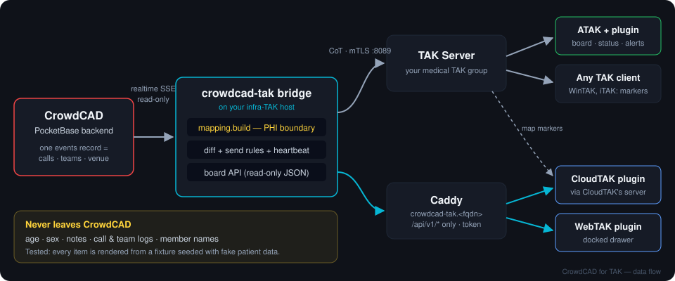
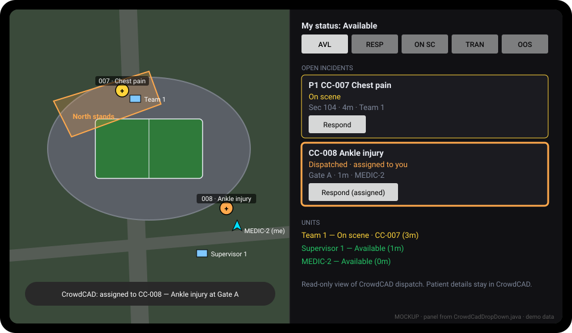
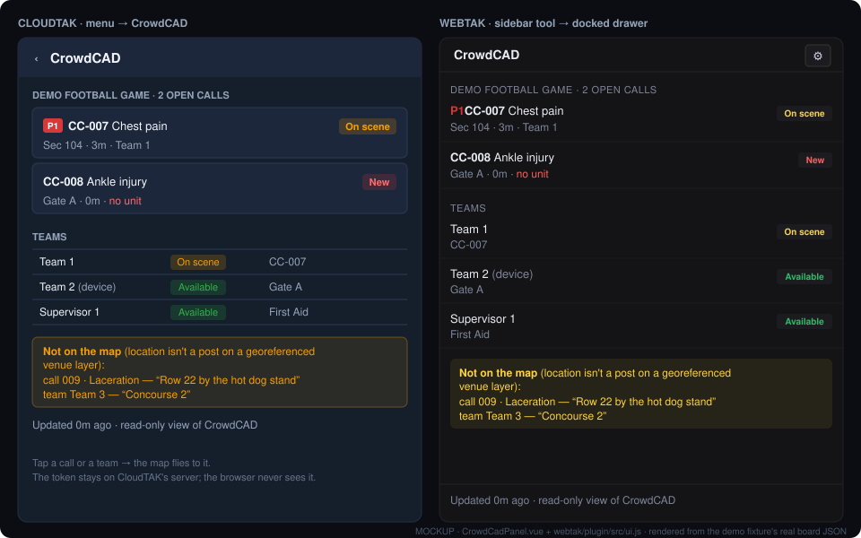
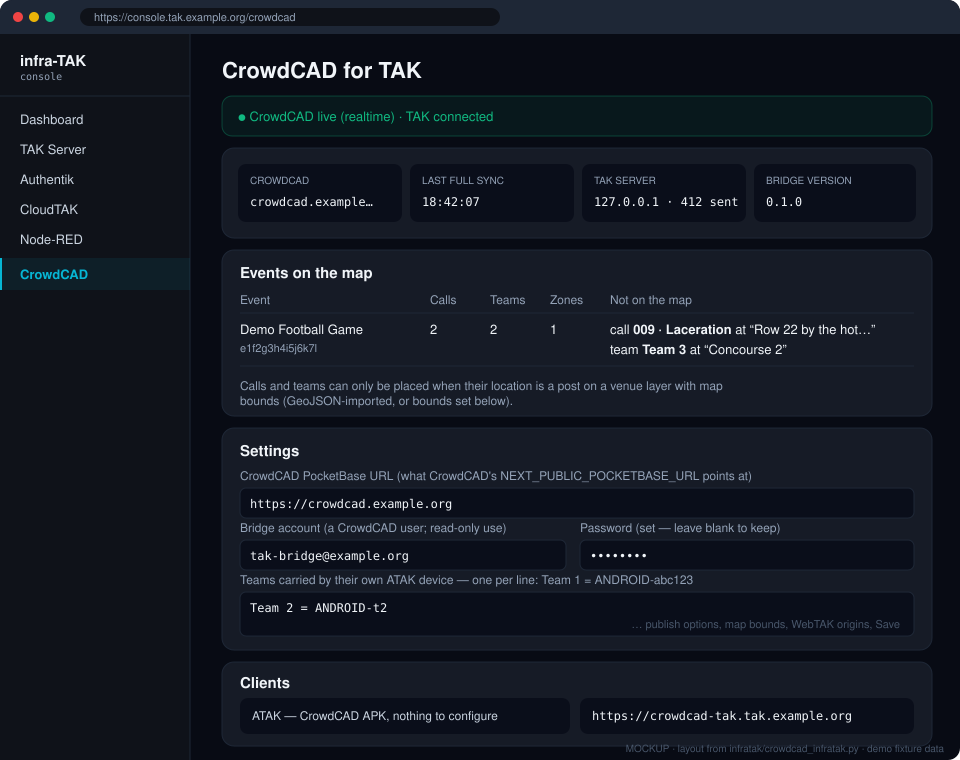
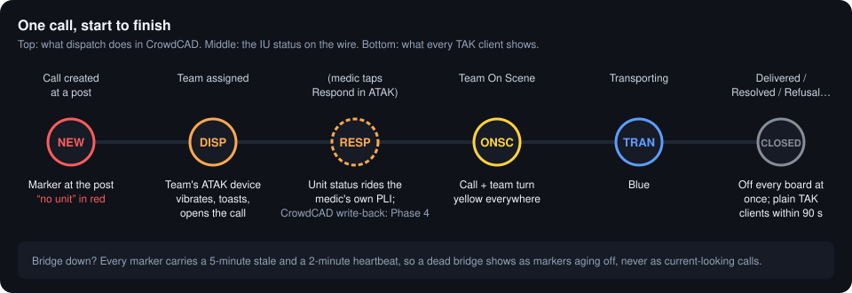

# CrowdCAD for TAK

**Puts a CrowdCAD event's live medical calls, teams and venue zones on every TAK client: ATAK,
CloudTAK and WebTAK, from one bridge on your infra-TAK server.** Medics see their assignment
and set their status from ATAK; command staff, the medical branch and the EOC watch the same
board in a browser. Nobody has to phone dispatch or look over the dispatcher's shoulder.

[CrowdCAD](https://github.com/evanqua/crowdcad) (Berkeley MRC, AGPL-3.0) is a free,
self-hostable dispatch board for event medical and collegiate EMS teams. This suite leaves
CrowdCAD unmodified.



> **Pictures on this page are mockups**, drawn from the real UI code and the demo fixture's
> real bridge output. They aren't screenshots: the suite has not yet run on a live host,
> device, CrowdCAD or TAK Server (see [Status](#status)).

**Contents:** [What each client shows](#what-each-client-shows) ·
[Key idea](#the-key-idea) · [Before you start](#before-you-start) ·
[Install walkthrough](#install-walkthrough) · [Game-day walkthrough](#game-day-walkthrough) ·
[Troubleshooting](#troubleshooting) · [Build & test](#build--test) · [Layout](#layout) ·
[Status](#status) · [Deviations](#deliberate-deviations-dont-fix-these-back) ·
[Decisions needed](#decisions-needed)

---

## What each client shows

### ATAK: the medic's view



- **Map:** calls show at their CrowdCAD post, teams as friendly units, and dispatch zones as
  shapes. Every ATAK, WinTAK or iTAK user in the group sees these markers, plugin or not.
- **Panel** (toolbar → CrowdCAD): **my status** buttons, open incidents (P1 first, colour =
  status, a thick border = assigned to you), then units. Tap a card and the map centres on it.
- **Assignment alert:** when dispatch assigns your team (your device is mapped to it on the
  console), the phone vibrates, shows a toast, and opens the call. **Respond** sets you
  Responding on that call.
- **Your status travels on your own position report**, so every other plugin user sees it. It
  is not written back into CrowdCAD yet ([Phase 4](docs/PLAN.md#phase-4-unit-status-from-the-field-bi-directional-teams)).
- No network permission and nothing to configure: the plugin reads CoT the device already gets.

### CloudTAK and WebTAK: command staff, medical branch, EOC



Both web clients show the **same board**: open calls, teams, and anything CrowdCAD couldn't
place on the map. It refreshes every 5 s. In CloudTAK, tapping a call or team flies the map to
it. The markers themselves reach both maps as ordinary CoT.

### infra-TAK console: the operator's view



A **CrowdCAD** page in the infra-TAK console (sidebar link and dashboard card) shows bridge
health, what's on the map and what isn't, settings, and the board URL and token for the web
clients.

---

## The key idea

**One bridge, one wire format, every client a thin reader.** The bridge on infra-TAK follows
CrowdCAD live and is the only thing that talks to it. It publishes the picture two ways, both
carrying exactly the same, patient-data-free content:

```
CrowdCAD (PocketBase) ──realtime──▶ bridge on infra-TAK ──CoT──▶ TAK Server ──▶ ATAK, WinTAK, CloudTAK & WebTAK maps
                                        │                                         ATAK plugin: board + status + alerts
                                        └──board API (crowdcad-tak.<fqdn>)──▶ CloudTAK plugin · WebTAK plugin
```

The CoT is **IU Event CAD's format** (`<__iucad_incident>` / `<__iucad_unit>`), not a new one.
So this suite's ATAK plugin and the IU Event CAD plugin read each other's traffic, and IU Event
CAD gets CrowdCAD calls for free (its plan's "Stage 3: real CAD").

The bridge's data model follows CrowdCAD's: **one PocketBase `events` record holds the whole
event**, so the TAK picture is a pure function of it (`mapping.build`), diffed and sent on
change. Reading is easy and safe. Writing back into CrowdCAD is the hard part, and it's why
TAK → CrowdCAD is a later phase ([docs/PLAN.md](docs/PLAN.md#phase-3-tak--crowdcad-the-proposals-model-2-medic-drops-a-marker--new-call)).

**What never leaves CrowdCAD:** age, sex, notes, call and team logs, member names. The only
clinical field sent is the chief complaint, as the incident type ([decision pending](#decisions-needed)).
This is enforced in one place and tested ([docs/COT_FORMAT.md](docs/COT_FORMAT.md#phi-rule-load-bearing)).

---

## Before you start

| You need | Why |
|---|---|
| An **infra-TAK** host (Ubuntu 22.04+, Python ≥ 3.10) with TAK Server | The bridge, its TAK certificate and the console page live there |
| **CrowdCAD on its PocketBase backend** (not Firebase), reachable from that host | It's the only backend with an API the bridge can follow |
| A **CrowdCAD user for the bridge** | The bridge only reads. Any signed-in user can read events |
| The **TAK group** your medics' devices are in | Without it, the bridge's markers go to `__ANON__` and nobody in a real group sees them |
| A venue map built by **GeoJSON import** in CrowdCAD (or map bounds typed on the console page) | CrowdCAD posts are percent-of-image. GeoJSON import is how they get real coordinates |
| *For the web clients:* a DNS record `crowdcad-tak.<your infra-TAK domain>` → the host | Caddy publishes the board API there |
| *For ATAK:* ATAK-CIV 5.6 | The plugin is built against the 5.6 SDK |

---

## Install walkthrough

> Use a **practice CrowdCAD event** for the first run, not a live one.

### 1. Get the code onto the infra-TAK host

```bash
git clone https://github.com/jpat-12/TAK-PluginSuite-CrowdCAD.git
```

The repo is private, so the host needs a GitHub deploy key or a personal access token. Or copy
the folder over with `scp`.

### 2. Install the bridge

Start with the bridge alone. `--cloudtak` rebuilds CloudTAK, which takes 5–15 min.

```bash
sudo bash TAK-PluginSuite-CrowdCAD/infratak/install.sh --tak-group MEDICAL
```

It should end with ✓ and no ⚠ lines (output abridged, illustrative):

```
==> CrowdCAD for TAK 0.1.0
==> Making TAK client cert 'crowdcad'
==> Bridge cert in TAK group(s): MEDICAL
==> Bridge is up (status on 127.0.0.1:8782)
==> infra-TAK console: /root/infra-TAK (…)
==> Console hook installed in /…/site-packages

✓ CrowdCAD for TAK 0.1.0 installed.
  Bridge:   systemctl status crowdcad-tak   (logs: journalctl -u crowdcad-tak -f)
  Next:     infra-TAK console → CrowdCAD → enter the CrowdCAD URL and bridge account
  Verify:   crowdcad-tak check    ·    crowdcad-tak preview   (prints CoT, sends nothing)
  Board:    https://crowdcad-tak.tak.example.org — token on the console page
  ATAK:     install ATAK-Plugin-CrowdCAD-*.apk on medics' and command devices (atak/ in the repo)
```

Re-running it is safe: it upgrades in place and never makes a second certificate or overwrites
your settings. All the options are in the header of [`infratak/install.sh`](infratak/install.sh).

### 3. Connect it to CrowdCAD

infra-TAK console → **CrowdCAD** (the banner is yellow, "waiting for settings") → enter:

- **CrowdCAD PocketBase URL**: whatever CrowdCAD's `NEXT_PUBLIC_POCKETBASE_URL` points at.
- **Bridge account** and password.
- Optional: **Teams carried by their own ATAK device**, e.g. `Team 2 = ANDROID-…` (the
  device UID). This mapping is what makes the assignment alert fire on that phone.

**Save and restart bridge**. The banner turns green: *CrowdCAD live (realtime) · TAK connected*.

### 4. Check before anyone looks at a map

```bash
crowdcad-tak check      # ✓ CrowdCAD: signed in …  ✓ TAK Server: TLS link up …
crowdcad-tak preview    # prints the CoT it would send for the active event; sends nothing
```

The console's **Events on the map** table shows counts per event, plus a **Not on the map**
list (calls or teams whose location isn't a georeferenced post). Fix those before game day.

### 5. Add the web clients (optional)

```bash
sudo bash TAK-PluginSuite-CrowdCAD/infratak/install.sh --tak-group MEDICAL --webtak --cloudtak
```

- **CloudTAK:** after the rebuild, go to Settings → **Refresh App** (a hard refresh isn't
  enough). CrowdCAD then appears in the menu.
- **WebTAK:** hard-refresh (Ctrl-Shift-R). Sidebar tool → **CrowdCAD**. If it can't reach the
  bridge, add WebTAK's exact page origin under *WebTAK page origins* on the console page.

### 6. Put the plugin on ATAK devices

APKs aren't committed. Build one ([Build & test](#build--test)), then:

```bash
adb install -r atak/app/build/outputs/apk/civ/debug/ATAK-Plugin-CrowdCAD-0.1.0-ATAK-5.6-civ-debug.apk
```

Then in ATAK: Plugins → load **CrowdCAD**. Devices must be in the same TAK group as the bridge.
**Don't install it alongside IU Event CAD** on one device: both put your status on your
position report.

**To remove:** `sudo bash /opt/crowdcad-tak/bin/uninstall.sh [--purge] [--cloudtak] [--webtak]`.
The full on-host checklist is in [docs/VERIFY.md](docs/VERIFY.md).

---

## Game-day walkthrough



**Before doors:** start the event in CrowdCAD on the GeoJSON-imported venue. Within seconds the
zones appear in ATAK. Check that the console's *Not on the map* list is empty, and map each team
that carries a device.

**During the event**, dispatch works only in CrowdCAD:

1. A call is created at a post. A marker appears there on every TAK client, and boards show
   it in red with *no unit*.
2. Dispatch assigns Team 2. Team 2's phone vibrates and opens the call, and the call turns
   *Dispatched* on every board.
3. The medic taps **Respond**. Every ATAK plugin user sees them *Responding*.
4. The team goes *On Scene*, then *Transporting*, in CrowdCAD. The call and the team change
   colour on every client.
5. The call is resolved (Delivered, Refusal, Treat and Release…). It leaves every board at
   once, and plain TAK clients drop the marker within 90 s.

**If the bridge dies**, nothing pretends to be current: markers carry a 5-minute stale with a
2-minute heartbeat, so they age off, and the web boards show a warning above the last good
board. **After the event:** end it in CrowdCAD and everything closes the same way.

---

## Troubleshooting

| You see | Likely cause → fix |
|---|---|
| Console banner yellow, "waiting for settings" | No CrowdCAD URL or account yet → step 3 |
| Banner says CrowdCAD *unreachable* | Wrong URL (it must be the **PocketBase** URL, not the Next.js site), or the account can't sign in → `crowdcad-tak check` |
| Banner says *polling — realtime unavailable* | A proxy in front of PocketBase is buffering SSE. Updates still arrive, about every 30 s |
| Nothing on ATAK, but `check` is ✓ | The device isn't in the bridge's TAK group. Re-run install with the right `--tak-group` |
| A call is on the boards but not the map | Its location isn't a post on a georeferenced layer (see *Not on the map*) → GeoJSON-import the venue, or enter layer bounds |
| Assignment alert doesn't fire | The team isn't mapped to that device UID on the console page |
| WebTAK: "can't reach the bridge" | Missing CORS origin → add WebTAK's exact page origin on the console page |
| CloudTAK: "speaks API vN; this plugin needs vM" | Bridge and plugin versions differ → re-run install with `--cloudtak` |
| CrowdCAD page gone after infra-TAK **Update Now** | The heal unit should re-apply it within seconds. If not, re-run `install.sh` |
| Logs | `journalctl -u crowdcad-tak -f` (lines prefixed `[crowdcad-tak]`) |

---

## Build & test

| Part | Command | Gate |
|---|---|---|
| Bridge + infra-TAK hook (Python ≥3.10, stdlib) | `cd bridge && python -m unittest discover -s tests` | 64 tests (6 need Flask; real-infra-TAK ones need `INFRATAK_REPO`, see VERIFY.md) |
| ATAK (5.6 SDK) | `cp atak/local.properties.example atak/local.properties` (edit), then `cd atak && JAVA_HOME="C:/Program Files/Android/Android Studio/jbr" ./gradlew assembleCivDebug testCivDebugUnitTest` | 9 JVM tests, incl. parsing real bridge output |
| WebTAK | `node --test webtak/test/` (node ≥18, no npm) · bundle: `python3 webtak/build.py` | 5 tests, incl. rendering a board the Python bridge made |
| CloudTAK (13.x) | compiled inside CloudTAK by `cloudtak/install.sh`; check first: `CLOUDTAK_DIR=/path/to/CloudTAK node cloudtak/check-in-cloudtak.mjs` | CloudTAK's own lint + vue-tsc |

After a wire-format change, regenerate the ATAK fixture: `python bridge/tests/make_atak_fixture.py`.

## Layout

```
VERSION                         one version for bridge, APK, CloudTAK + WebTAK plugins (PATCH-bump per build)
docs/
  COT_FORMAT.md                 what goes on the wire: CrowdCAD field → CoT attribute, send rules, PHI rule
  API.md                        the read-only board API the web clients build against
  PLAN.md                       phases: CrowdCAD→TAK, infra-TAK deploys CrowdCAD, TAK→CrowdCAD, w3w
  VERIFY.md                     release smoke test (automated + on-host + device steps)
  images/                       README mockups (SVG, drawn from the UI code + demo fixture; not screenshots)
bridge/                         the service (Python ≥3.10, stdlib only, no venv)
  crowdcad_tak/
    mapping.py                  event record → items (pure); status maps; the PHI boundary
    geo.py                      post/zone percent-of-map → lat/lon (inverse of CrowdCAD's own math)
    cot.py                      item → CoT XML (IU __iucad_* details, zones as u-d-f shapes)
    bridge.py                   Publisher: canonical "what TAK was told" + send rules; Runner: threads/IO
    board.py                    Publisher state → the web board (API.md)
    api.py                      HTTP: /status (console, loopback only), /api/v1/info, /api/v1/board (token)
    pocketbase.py               PocketBase REST + realtime SSE client (auth, list, subscribe)
    takclient.py                mutual-TLS CoT stream to TAK Server, reconnect + resend
    config.py                   config.json / secrets.json, defaults spread under file contents
    __main__.py                 CLI: serve · check · preview · version
  tests/                        bridge, board/API, PocketBase fakes, real TLS, Caddy, console hook
    fixtures/event_demo_stadium.json   illustrative event in CrowdCAD 1.6.0's shape (invented people)
    make_atak_fixture.py        writes atak/app/src/test/resources/bridge-demo.cot from the fixture
infratak/                       infra-TAK integration (never edits infra-TAK's tracked files)
  install.sh / uninstall.sh     one command: bridge, TAK cert + group, Caddy, console hook, web clients
  crowdcad_infratak.py          console hook: /crowdcad status + settings + client info, card, sidebar
  crowdcad_infratak_boot.py, .pth  loads the hook when gunicorn imports the console's app (Aleph-safe)
  crowdcad_caddy.py             crowdcad-tak.<fqdn> site, API paths only, below the user-blocks marker
  lib.sh, heal.sh, systemd/     shared shell; re-apply after Caddyfile rewrites / "Update Now"; units
atak/                           ATAK plugin (Java, ATAK-CIV 5.6 SDK, no network permission)
  app/src/main/java/com/atakmap/android/crowdcad/
    CrowdCadMapComponent.java   owns the board, CoT handlers, status reporter, panel; assignment alert
    CrowdCadDropDown.java       the panel: my status, open incidents (tap → map, Respond), units
    IncidentHandler.java, UnitHandler.java   __iucad_* details from any source → Board
    StatusReporter.java         my status on my own PLI (persisted across restarts)
    cot/                        IucadIncident, IucadUnit: parse/serialise (pure, tested)
    model/                      Board (newest wins, closed stays closed, stale expires), Incident, Unit, statuses
  app/src/test/                 JVM tests; resources/bridge-demo.cot is real bridge output
cloudtak/                       CloudTAK plugin
  plugin/                       web half → <CloudTAK>/…/plugins/crowdcad/ (Vue 3 board panel, tap → map)
  server/plugin-crowdcad.ts     server half: relays /board with the token, which never reaches the browser
  install.sh, check-in-cloudtak.mjs   install into either CloudTAK layout; run CloudTAK's build gates
webtak/                         WebTAK plugin (plain DOM, WebTAK 4.10 drawer API, floating fallback)
  plugin/                       index.js (registration) + src/ (config, client, format, ui, styles, core)
  build.py                      bundles to one classic script; bakes in bridge URL + token at install
  install.sh                    builds + registers in webtak-manifest.json
  test/board.test.mjs           contract + bundle-boot tests
```

## Status

| Feature (docs/PLAN.md) | State | Notes |
|---|---|---|
| Bridge: calls → IU incidents, teams → units, zones → shapes | ✅ | Tested against fakes; **not yet run against a live CrowdCAD or TAK Server** |
| Bridge: realtime with polling fallback, mutual TLS, PHI kept out | ✅ | TLS tested against a local server with a makeCert-style encrypted key |
| Board API + Caddy site | ✅ | Token + CORS + `/status` never proxied; tested |
| infra-TAK console page, card, sidebar | ✅ | Verified on infra-TAK v0.1.0 → current HEAD, **alongside Aleph's hook** |
| ATAK plugin: board, my status on PLI, assignment alert, tap → map | 🔧 Built | Debug + release APKs build; 9 JVM tests pass; **not yet on a device** |
| CloudTAK plugin | 🔧 Built | Same structure as Aleph's (which passes CloudTAK 13.14.1's gates); **CloudTAK's lint + vue-tsc not yet run on this one** |
| WebTAK plugin | 🔧 Built | Registration shape from WebTAK-Plugin-Channels (in production); bundle boot-tested in a stub; **not yet in a live WebTAK** |
| `install.sh` on a real host | 🔧 Built | Not yet run on a server: VERIFY.md |
| WebTAK tap → map | ⬜ | No verified WebTAK map API for plugins; positions are on the map as CoT anyway |
| WinTAK | ⬜ | Not in scope yet; WinTAK shows the CoT markers and shapes without a plugin |
| Phase 2: infra-TAK deploys CrowdCAD itself (+ offline field node) | ⬜ Next | Caddy routing designed in PLAN.md |
| Phase 3: TAK marker → new CrowdCAD call | ⬜ Designed | Blocked on safe writes (CrowdCAD's `calls` is one array, no concurrency check); plan: a PocketBase hook |
| Phase 4: medic status from ATAK → CrowdCAD team status | ⬜ | Status already rides the PLI; writing it into CrowdCAD has the same constraint |
| what3words → call location | ⬜ | Server-side key only (IU rule); rides on Phase 3 |

## Deliberate deviations (don't "fix" these back)

- **Web clients use the board API, ATAK uses CoT.** ATAK already receives every marker and keeps
  working when the bridge is unreachable. WebTAK exposes no verified way for a plugin to read
  received CoT, so the web clients get the same content as JSON.
- **The ATAK plugin has no INTERNET permission**: it has no network surface of its own.
- **WebTAK bundle is built at install, never committed** (unlike the sibling WebTAK plugins):
  it carries the board token.
- **Linear placement, not Web Mercator.** CrowdCAD maps lat/lng onto its image linearly;
  inverting that exactly keeps a post where the dispatcher sees it.
- **A post's own `lat/lng` is only a fallback.** CrowdCAD never updates it when a post is dragged.
- **Unplaceable calls aren't sent**, only listed (console page, every board). No guessed
  location for a patient.
- **Unmapped team statuses (e.g. Assigned) send no unit status at all** (IU's rule).
- **CrowdCAD priority flag → IU priority 1, else 2.** CrowdCAD has no 1–3 scale.
- **Short stale + heartbeat** (5 min / 2 min) instead of IU's 12 h: a dead bridge must not
  leave calls that look current; every client's board expires stale entries the same way.
- **Hostname not checked on the bridge's TAK link** (it dials 127.0.0.1; TAK's cert names the
  FQDN). The chain is still verified against TAK's CA.

## Decisions needed

| Question | What this build assumes until decided |
|---|---|
| Is the chief complaint OK on TAK devices? (only clinical field sent) | Yes, as IU's `type`, same as IU Event CAD's own incidents |
| Which TAK group(s) should see CrowdCAD? | Whatever `--tak-group` says; none = `__ANON__` (installer warns) |
| Should IU Event CAD become a configuration of this ATAK plugin later? | Separate for now (game-day freeze); same wire format, so either works |
| Incident id prefix | `CC-<order>`; per-event override available |
| License for this repo | None chosen yet. It talks to CrowdCAD over its API and copies no CrowdCAD code |
| Raise an append-calls endpoint with CrowdCAD upstream? | Not yet; PLAN.md Phase 3 explains why it matters |
