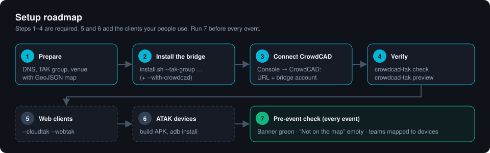
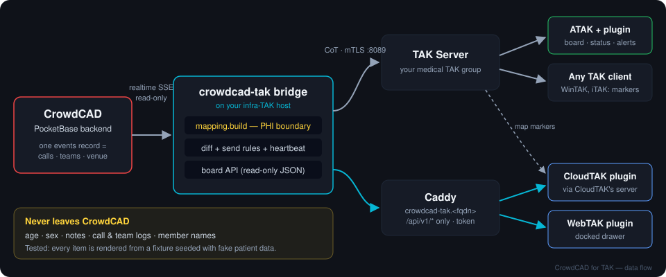
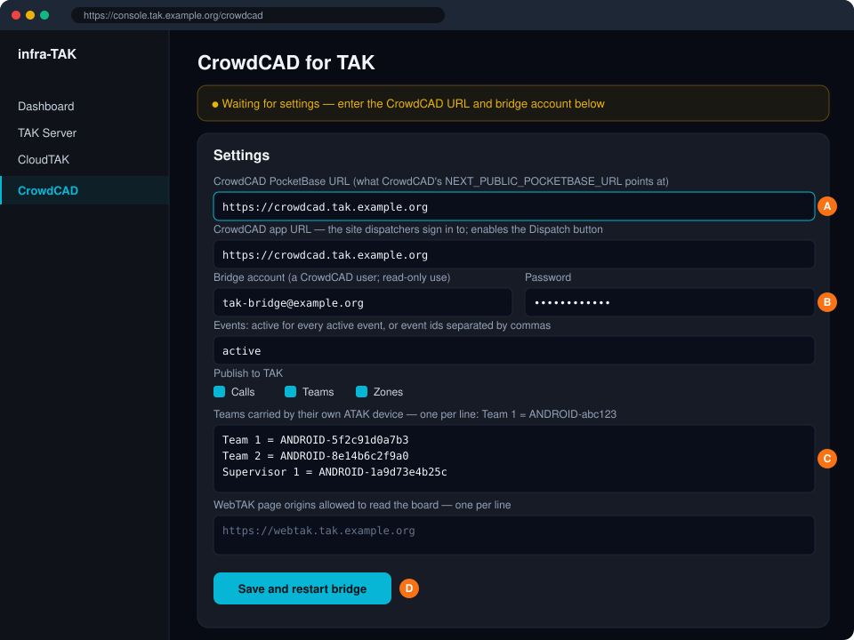
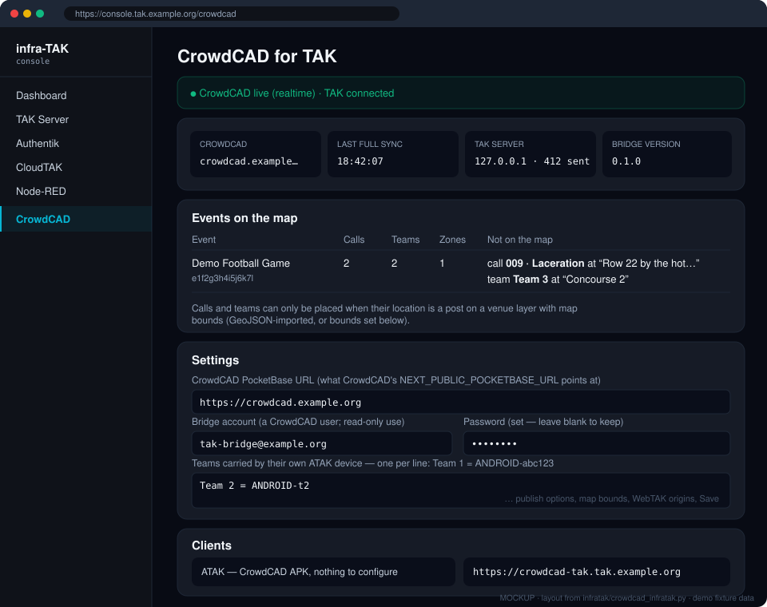
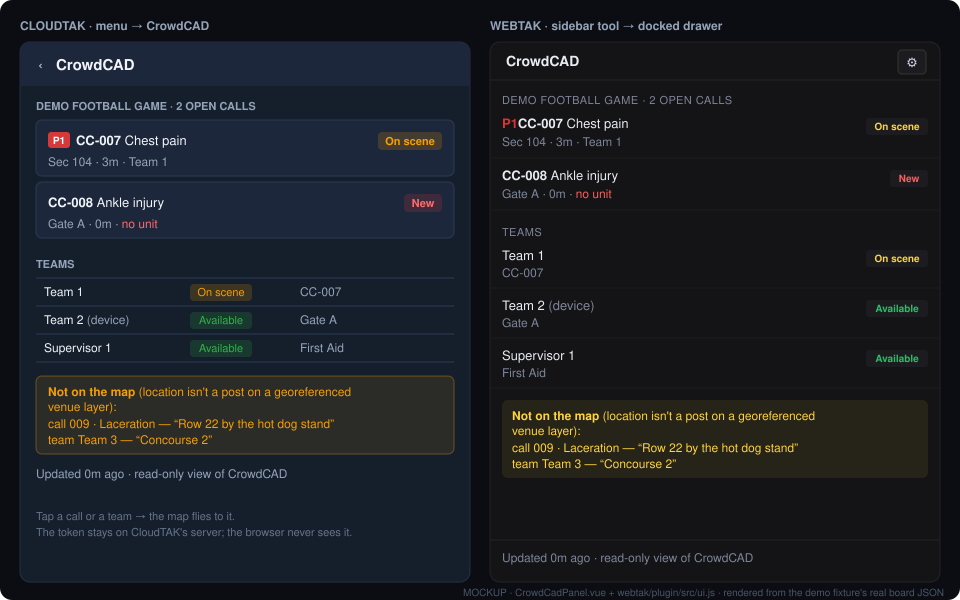

# CrowdCAD for TAK: Setup Guide

**For:** the person who runs the infra-TAK server (the operator).
**You get:** a CrowdCAD event's calls, teams and venue zones on every ATAK, CloudTAK and
WebTAK client, plus dispatch from inside CloudTAK.
**Time:** about 30 minutes for the bridge, plus 5–15 minutes if you add CloudTAK.

> **About the pictures:** every image in this guide is a mockup. Each one is drawn from the real
> UI code and the demo fixture's bridge output, but none is a screenshot. The ATAK plugin, the
> CloudTAK plugin and the WebTAK plugin have not all run on live devices yet. See *Status* in the
> [README](../README.md#status).

The companion [User Guide](USER_GUIDE.md) is for medics, dispatchers and command staff.

---

## Contents

1. [How it fits together](#how-it-fits-together)
2. [Before you start](#before-you-start)
3. [Step 1: Prepare](#step-1-prepare)
4. [Step 2: Install the bridge](#step-2-install-the-bridge)
5. [Step 3: Connect the bridge to CrowdCAD](#step-3-connect-the-bridge-to-crowdcad)
6. [Step 4: Verify](#step-4-verify)
7. [Step 5: Add the web clients (CloudTAK, WebTAK)](#step-5-add-the-web-clients-cloudtak-webtak)
8. [Step 6: Put the plugin on ATAK devices](#step-6-put-the-plugin-on-atak-devices)
9. [Step 7: Pre-event checklist](#step-7-pre-event-checklist)
10. [Upgrading and removing](#upgrading-and-removing)
11. [Troubleshooting](#troubleshooting)
12. [Reference](#reference)

---

## How it fits together



One **bridge** runs on your infra-TAK host. It is the only part that talks to CrowdCAD. It
follows CrowdCAD live and publishes the same picture two ways:

- as **CoT** through your TAK Server, so every ATAK, WinTAK, iTAK, CloudTAK and WebTAK map shows
  the markers, with or without a plugin;
- as a **board API** at `https://crowdcad-tak.<your domain>`, which the CloudTAK and WebTAK
  plugins read.



**Patient data stays in CrowdCAD.** Age, sex, notes, call and team logs and member names are
never sent. The only clinical field that leaves is the chief complaint, shown as the incident
type.

---

## Before you start

Tick every line before you install.

| ✓ | You need | Why |
|---|---|---|
| ☐ | An **infra-TAK** host (Ubuntu 22.04+, Python ≥ 3.10) with TAK Server running | The bridge, its TAK certificate and the console page live there |
| ☐ | **CrowdCAD on PocketBase** (not Firebase), reachable from the host, **or** Docker on the host so the installer can run CrowdCAD for you (`--with-crowdcad`) | PocketBase is the only CrowdCAD backend with an API the bridge can follow |
| ☐ | A **CrowdCAD user for the bridge**, e.g. `tak-bridge@example.org` (skip with `--with-crowdcad`: it is created for you) | The bridge signs in as this user |
| ☐ | The name of the **TAK group** your medics' devices are in, e.g. `MEDICAL` | Without it the markers go to `__ANON__` and no one in a real group sees them |
| ☐ | A **venue built by GeoJSON import** in CrowdCAD | CrowdCAD posts are positions on an image. GeoJSON import gives them real coordinates |
| ☐ | DNS: `crowdcad-tak.<your domain>` → the host (for the web clients) and `crowdcad.<your domain>` → the host (only with `--with-crowdcad`) | Caddy publishes the board API and the CrowdCAD app there |
| ☐ | For ATAK: devices on **ATAK-CIV 5.6 or 5.7**, and a PC with Android Studio to build the APK | There is one APK per ATAK version |

> **Do your first run against a practice CrowdCAD event,** never a live one.

---

## Step 1: Prepare

1. **Create the DNS records** listed above and wait until they resolve:

   ```bash
   dig +short crowdcad-tak.tak.example.org
   ```

2. **Confirm the TAK group name.** In the TAK Server admin UI, open a medic's user and note
   the group exactly as written (it is case-sensitive).

3. **Build the venue in CrowdCAD with GeoJSON import.** In CrowdCAD, create the venue, import
   the GIS map (GeoJSON) and place your posts on it. Venues built from a plain image can still be
   used, but then you must type map bounds on the console page (Step 3), or nothing will reach the
   TAK map.

4. **Create the bridge's CrowdCAD user** (skip this if you will use `--with-crowdcad`). Any
   signed-in CrowdCAD user can read events, so an ordinary account is enough. For CloudTAK dispatch
   on events not created from CloudTAK, share the event with this account or make it an org event.

---

## Step 2: Install the bridge

Copy the repository onto the infra-TAK host. It is private, so use a deploy key or a personal
access token, or copy the folder with `scp`:

```bash
git clone https://github.com/jpat-12/TAK-PluginSuite-CrowdCAD.git
```

Then choose **one** of the two options.

### Option A: you already run CrowdCAD

```bash
sudo bash TAK-PluginSuite-CrowdCAD/infratak/install.sh --tak-group MEDICAL
```

### Option B: run CrowdCAD on this host too

```bash
sudo bash TAK-PluginSuite-CrowdCAD/infratak/install.sh --tak-group MEDICAL --with-crowdcad
```

This builds upstream CrowdCAD (release `v1.6.0`, unmodified) on PocketBase in Docker, publishes
it at `https://crowdcad.<your domain>`, creates the first CrowdCAD admin, a PocketBase superuser
and the bridge account, and points the bridge at it. **With Option B you can skip Step 3.**
The first build takes several minutes.

- **Sign-in details** are in `/opt/crowdcad-tak/crowdcad/credentials.json` (root only).
  `admin` is the CrowdCAD login. `superuser` is for PocketBase's admin UI at
  `https://crowdcad.<your domain>/_/`.
- **Public sign-up is closed** because any CrowdCAD user can read every event. Add people with:

  ```bash
  sudo python3 /opt/crowdcad-tak/bin/crowdcad_app.py add-user medic.lead@example.org --admin
  ```

  It prints a one-time password.
- **Back up** `/opt/crowdcad-tak/crowdcad/pb_data/`: it holds every venue, event and call.

### What success looks like

The installer ends with a ✓ line and no ⚠ lines (output abridged):

```
==> CrowdCAD for TAK 0.1.0
==> Making TAK client cert 'crowdcad'
==> Bridge cert in TAK group(s): MEDICAL
==> Bridge is up (status on 127.0.0.1:8782)
==> Console hook installed in /…/site-packages

✓ CrowdCAD for TAK 0.1.0 installed.
  Bridge:   systemctl status crowdcad-tak   (logs: journalctl -u crowdcad-tak -f)
  Next:     infra-TAK console → CrowdCAD → enter the CrowdCAD URL and bridge account
  Verify:   crowdcad-tak check    ·    crowdcad-tak preview   (prints CoT, sends nothing)
  Board:    https://crowdcad-tak.tak.example.org — token on the console page
```

Re-running the installer is safe. It upgrades in place and never makes a second certificate or
overwrites your settings. Every option is listed in the header of
[`infratak/install.sh`](../infratak/install.sh).

---

## Step 3: Connect the bridge to CrowdCAD

Open the **infra-TAK console → CrowdCAD** (sidebar link, or the dashboard card). The banner is
yellow: *waiting for settings*.



| Callout | Field | What to enter |
|---|---|---|
| **A** | **CrowdCAD PocketBase URL** | The **PocketBase** address, i.e. whatever CrowdCAD's `NEXT_PUBLIC_POCKETBASE_URL` points at. Not the address of the Next.js site, unless they are the same. |
| | **CrowdCAD app URL** | The site dispatchers sign in to. Filling it in turns on the **Dispatch** button in CloudTAK and WebTAK. |
| **B** | **Bridge account / Password** | The CrowdCAD user from Step 1. Leave the password blank later to keep the saved one. |
| | **Events** | `active` follows every active event. Or list event ids, separated by commas. |
| | **Publish to TAK** | Leave Calls, Teams and Zones ticked. |
| **C** | **Teams carried by their own ATAK device** | One line per unit: `Team 1 = ANDROID-…`. The right-hand side is the device UID (TAK Server's admin UI lists it for each connected client). This is what makes the assignment alert fire on that phone and lets the phone's status taps update CrowdCAD. Events created from CloudTAK fill this in for you. |
| | **Map bounds** | Only for venues without GeoJSON import: JSON with north/south/east/west per layer. |
| | **WebTAK page origins** | Only if you use WebTAK: its exact page origin, e.g. `https://webtak.tak.example.org`. |
| **D** | **Save and restart bridge** | Click it. |

The banner turns green: **CrowdCAD live (realtime) · TAK connected**.

---

## Step 4: Verify

On the host:

```bash
crowdcad-tak check      # ✓ CrowdCAD: signed in …   ✓ TAK Server: TLS link up …
crowdcad-tak preview    # prints the CoT it would send for the active event; sends nothing
```

Then look at the console page:



- **Status tiles:** CrowdCAD URL, last full sync, TAK Server and the count of messages sent,
  and the bridge version.
- **Events on the map:** counts of calls, teams and zones per event.
- **Not on the map:** calls or teams whose location isn't a mapped post. **This list should
  be empty before an event.** Fix each entry by moving it to a post on a GeoJSON-imported
  layer.
- **Clients:** the board URL and token for CloudTAK and WebTAK.

Quick end-to-end test with a practice event:

1. In CrowdCAD, start the practice event on the GeoJSON-imported venue. Zones appear in ATAK
   within seconds.
2. Create a call at a post. A marker appears at that post on every TAK map.
3. Resolve the call. It leaves every board at once, and plain TAK maps drop it within about
   90 seconds.

---

## Step 5: Add the web clients (CloudTAK, WebTAK)

Skip this step if no one will use CloudTAK or WebTAK. Re-run the installer with the clients
you want:

```bash
sudo bash TAK-PluginSuite-CrowdCAD/infratak/install.sh --tak-group MEDICAL --cloudtak --webtak
```

- **CloudTAK** is rebuilt, which takes 5–15 minutes. Afterwards, in CloudTAK go to
  **Settings → Refresh App** (a browser hard refresh is not enough). **CrowdCAD** then appears
  in the menu.
- **WebTAK:** hard-refresh the page (Ctrl + Shift + R). Open the sidebar tool **CrowdCAD**. If
  it says it can't reach the bridge, add WebTAK's exact page origin under *WebTAK page
  origins* on the console page (Step 3).



---

### TAK groups: the bridge must share a group with the phones

The bridge's TAK certificate must be in the same TAK group as the medics' devices (and CloudTAK
users), or the phones never get the calls and alerts and the bridge never hears the phones (no
positions, no radar). With TAK Portal / LDAP group assignment (`<auth default="ldap"
x509groups="true">`), groups for certificates come from the directory, not TAK Server's
UserAuthenticationFile:

1. TAK Portal → **Integrations** → **Create Integration**: Type **Global**, title `crowdcad`,
   *Make Streaming Data Feed?* **No**, groups **ALL** (+ **CAD**): the same as the IU bridge's
   `global-iucad`. Download its certs.
2. Copy `global-crowdcad.pem` and `.key` to `/opt/crowdcad-tak/certs/` (root:crowdcad-tak, 0640;
   re-encrypt the key with the bridge's `tak_key_password` from secrets.json, or set that to the
   key's password), and set `tak_cert` / `tak_key` in `/opt/crowdcad-tak/data/config.json`.
3. `systemctl restart crowdcad-tak`. If the integration was created moments before, TAK Server may
   cache "no groups" for the first connection: restart the bridge once more after a minute.
4. Check: the dispatcher's units show a position and "seen" time for phones that carry them.

### CloudTAK: show calls with the CrowdCAD icons

Calls carry `<usericon>` naming the CrowdCAD iconset's priority icons (`EMS P1/P2/P3.png`). Import
`atak/app/src/main/assets/iconsets/CrowdCAD.zip` once in CloudTAK (Iconsets) so CloudTAK draws them;
ATAK gets the iconset from the plugin. Until then calls keep CloudTAK's default marker.

## Step 6: Put the plugin on ATAK devices

APKs are not committed to the repository. Build one on a PC with Android Studio and the
ATAK-CIV SDK that matches your devices.

1. **Configure the SDK paths.**

   ```bash
   cp atak/local.properties.example atak/local.properties   # then edit the three SDK paths
   ```

   For ATAK 5.7, point the paths at the 5.7 SDK and add `atak.version=5.7.0`.

2. **Build and test.**

   ```bash
   cd atak
   JAVA_HOME="C:/Program Files/Android/Android Studio/jbr" ./gradlew assembleCivDebug testCivDebugUnitTest
   ```

   On Linux run `bash ./gradlew …`. Output:
   `app/build/outputs/apk/civ/debug/ATAK-Plugin-CrowdCAD-0.1.0-ATAK-5.6-civ-debug.apk`.

3. **Install on each device.**

   ```bash
   adb install -r app/build/outputs/apk/civ/debug/ATAK-Plugin-CrowdCAD-0.1.0-ATAK-5.6-civ-debug.apk
   ```

4. **Load it in ATAK:** *Plugins* → load **CrowdCAD**. A CrowdCAD button appears in the
   toolbar.

5. **Put the device in the same TAK group as the bridge.**

6. **Note the device UID** (`ANDROID-…`, listed for each connected client in TAK Server's admin UI) and map it to its team on the console
   page (Step 3, callout C), unless you'll create the event from CloudTAK.

> **Don't install it alongside IU Event CAD** on the same device. Both put your status on your
> position report. (The two plugins do read each other's markers, since they share the wire
> format.)

The ATAK plugin has no network permission and nothing to configure: it reads the CoT the
device already receives.

---

## Step 7: Pre-event checklist

Run this before **every** event, ideally an hour before doors.

| ✓ | Check | Where |
|---|---|---|
| ☐ | Banner is green: *CrowdCAD live (realtime) · TAK connected* | Console → CrowdCAD |
| ☐ | `crowdcad-tak check` shows two ✓ | Host shell |
| ☐ | The event is started in CrowdCAD on the **GeoJSON-imported** venue | CrowdCAD |
| ☐ | Zones appear on an ATAK device in the right TAK group | ATAK |
| ☐ | **Not on the map** list is empty | Console, or any board |
| ☐ | Every team carrying a phone is mapped to its device UID | Console → Settings, callout C |
| ☐ | Each medic device has the plugin loaded and shows *Assigned to you* / *No call assigned to you* | ATAK → CrowdCAD |
| ☐ | Dispatchers can open **Dispatch** and sign in to CrowdCAD (if using the CrowdCAD screen) | CloudTAK / WebTAK |
| ☐ | A test call at a post shows on every client, then resolve it | CrowdCAD + clients |

---

## Upgrading and removing

**Upgrade:** pull the new code and run the same `install.sh` command again. It upgrades in place.

> **Upgrading CrowdCAD itself** (`--crowdcad-ref`)? The CloudTAK native dispatch is a port of
> CrowdCAD v1.6.0's own handlers. Check that it still matches the new CrowdCAD version
> before you upgrade a live system.

**Remove:**

```bash
sudo bash /opt/crowdcad-tak/bin/uninstall.sh [--purge] [--cloudtak] [--webtak] [--crowdcad]
```

- Without `--crowdcad`, a CrowdCAD that `--with-crowdcad` installed keeps running with its data.
- `--crowdcad --purge` **deletes every CrowdCAD event and call.** Back up `pb_data/` first.

**After infra-TAK "Update Now":** the CrowdCAD console page is re-applied automatically
within seconds. If it isn't, re-run `install.sh`.

---

## Troubleshooting

| You see | Likely cause → fix |
|---|---|
| Banner yellow, *waiting for settings* | No CrowdCAD URL or account yet → Step 3 |
| Banner says CrowdCAD *unreachable* | URL is the Next.js site instead of **PocketBase**, or the account can't sign in → `crowdcad-tak check` |
| Banner says *polling — realtime unavailable* | A proxy in front of PocketBase buffers live updates (SSE). Updates still arrive about every 30 s |
| Nothing on ATAK, but `check` is ✓ | Device isn't in the bridge's TAK group → re-run install with the right `--tak-group` |
| ATAK plugin says *No open incidents* while CrowdCAD has calls | Every call is *Not on the map*: venue isn't GeoJSON-imported, or calls use free-text locations. The bridge never guesses a patient location |
| A call is on the boards but not the map | Its location isn't a post on a georeferenced layer → GeoJSON-import the venue, or enter map bounds |
| Assignment alert doesn't fire | That team isn't mapped to the device UID (Step 3, callout C) |
| WebTAK: *can't reach the bridge* | Add WebTAK's exact page origin on the console page |
| CloudTAK: *speaks API vN; this plugin needs vM* | Bridge and plugin versions differ → re-run install with `--cloudtak` |
| No **Dispatch** button | *CrowdCAD app URL* is empty on the console page |
| Native dispatch refuses to save | The bridge's CrowdCAD account can't update that event → make it an org event or share it with the bridge account |
| CrowdCAD page gone after infra-TAK **Update Now** | Should heal itself within seconds; otherwise re-run `install.sh` |

**Logs:** `journalctl -u crowdcad-tak -f` (lines start with `[crowdcad-tak]`).
**Status JSON:** `curl -s 127.0.0.1:8782/status`.

---

## Reference

### Commands

| Command | What it does |
|---|---|
| `crowdcad-tak check` | Signs in to CrowdCAD and opens the TAK link, then reports ✓ / ✗ for each |
| `crowdcad-tak preview` | Prints the CoT for the active event. Sends nothing |
| `crowdcad-tak version` | Bridge version |
| `systemctl status crowdcad-tak` | Is the bridge running |
| `journalctl -u crowdcad-tak -f` | Live bridge log |
| `sudo python3 /opt/crowdcad-tak/bin/crowdcad_app.py status` | CrowdCAD-on-host status (Option B) |
| `sudo python3 /opt/crowdcad-tak/bin/crowdcad_app.py add-user EMAIL [--admin]` | Add a CrowdCAD user (Option B) |

### Installer options (most used)

| Option | Meaning |
|---|---|
| `--tak-group NAME` | TAK group(s) the bridge publishes to |
| `--with-crowdcad` | Build and run CrowdCAD on this host |
| `--crowdcad-domain`, `--crowdcad-ref`, `--crowdcad-admin EMAIL` | Options for `--with-crowdcad` |
| `--crowdcad-signup open` | Leave CrowdCAD sign-up open (not recommended) |
| `--cloudtak`, `--webtak` | Install the web client plugins |

### Files on the host

| Path | Contents |
|---|---|
| `/opt/crowdcad-tak/` | Bridge install, scripts in `bin/` |
| `/opt/crowdcad-tak/crowdcad/credentials.json` | CrowdCAD admin, superuser and bridge passwords (Option B, root only) |
| `/opt/crowdcad-tak/crowdcad/pb_data/` | Every CrowdCAD venue, event and call (Option B). **Back it up** |

### Further reading

- [README](../README.md): overview, status, design decisions
- [docs/VERIFY.md](../docs/VERIFY.md): the full release smoke test
- [docs/API.md](../docs/API.md): the board API
- [docs/COT_FORMAT.md](../docs/COT_FORMAT.md): what goes on the wire, and the PHI rule
