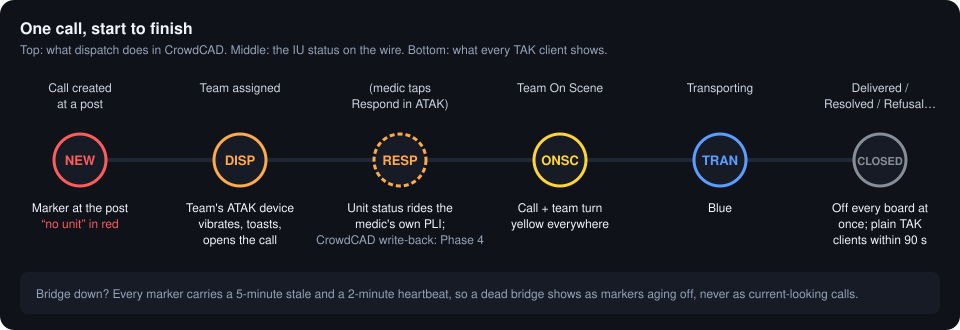
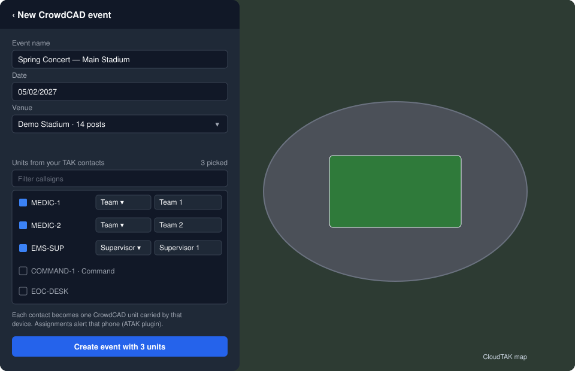
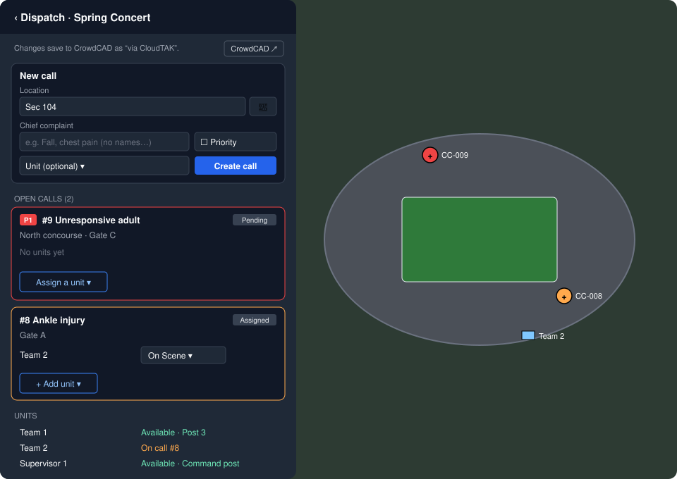
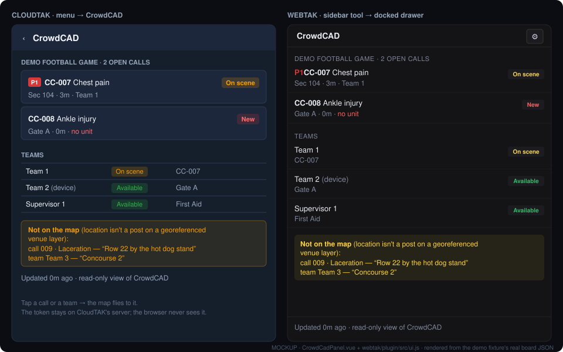

# CrowdCAD for TAK: User Guide

**For:** medics on ATAK, dispatchers, and command staff, the medical branch and the EOC on
CloudTAK or WebTAK.
**In short:** CrowdCAD's live calls, teams and venue zones appear on your TAK map. Medics see
their assignments and set their status from ATAK. Everyone else watches the same board in a
browser, and dispatchers can dispatch from inside CloudTAK.

> **About the pictures:** every image in this guide is a mockup drawn from the real UI code,
> not a screenshot. Your screen may differ slightly.

Your operator sets the system up first; see the [Setup Guide](SETUP_GUIDE.md).

---

## Contents

1. [Which part do I use?](#which-part-do-i-use)
2. [The basics](#the-basics)
3. [Medics: ATAK](#medics-atak)
4. [Dispatchers: CloudTAK](#dispatchers-cloudtak)
5. [Command staff and EOC: CloudTAK or WebTAK](#command-staff-and-eoc-cloudtak-or-webtak)
6. [Game day, start to finish](#game-day-start-to-finish)
7. [When something looks wrong](#when-something-looks-wrong)
8. [Quick reference cards](#quick-reference-cards)

---

## Which part do I use?

| You are | You use | You can |
|---|---|---|
| **Medic / field team** | ATAK with the CrowdCAD plugin | See calls and teams, get assignment alerts, set your status |
| **Dispatcher** | CloudTAK (CrowdCAD → Dispatch), or CrowdCAD itself | Create events and calls, assign units, change statuses, close calls |
| **Command staff, medical branch, EOC** | CloudTAK or WebTAK (CrowdCAD panel) | Watch the board: open calls, teams, anything not on the map |
| **Anyone else on TAK** (ATAK without the plugin, WinTAK, iTAK) | Your normal map | See call and team markers and zones |

---

## The basics

### What you see on the map

| On the map | Means |
|---|---|
| ⊕ coloured circle, labelled `CC-008 · Ankle injury` | A **call** (incident) at a CrowdCAD post |
| Blue friendly unit, labelled `Team 2` | A **team** or **supervisor** |
| Shaded shape, e.g. *North stands* | A **dispatch zone** from the CrowdCAD venue |

### Call status codes



| Code | Meaning |
|---|---|
| **NEW** | Call created, no unit yet (shown red, *no unit*) |
| **DISP** | A unit has been dispatched |
| **RESP** | The unit is responding (en route) |
| **ONSC** | The unit is on scene |
| **TRAN** | The unit is transporting |
| **CLOSED** | Resolved in CrowdCAD (Delivered, Refusal, Treat and Release…). The call leaves every board at once |

**P1** marks a call CrowdCAD flagged as priority. P1 calls sort first.

### What is and isn't shared

The **chief complaint** (e.g. *Chest pain*) is the only clinical detail that reaches TAK.
**Age, sex, notes, call logs and names never leave CrowdCAD.** When you type a chief
complaint, don't put names, age or sex in it.

### "Not on the map"

A call or team appears under **Not on the map** when its location isn't a mapped post, for
example a free-text location like *row 114*. It shows on the boards but gets no map marker,
because the system never guesses where a patient is. Ask dispatch to move it to a post.

---

## Medics: ATAK


### Open the panel

Tap the **CrowdCAD** button in the ATAK toolbar. The panel shows, from top to bottom:

1. **My status:** five buttons. The current one is highlighted.
2. **Open incidents:** P1 first. The border colour is the call status. A **thick border**
   means *assigned to you*.
3. **Units:** every team and supervisor with their status.

Tap any card to centre the map on it.

### Set your status

| Button | Status | What happens in CrowdCAD (if your device carries a unit) |
|---|---|---|
| **AVL** | Available | Clears you from your call (closes it as *Resolved* if you were the last unit on it), or sets you Available |
| **RESP** | Responding | Sets you Responding on your call |
| **ON SC** | On scene | Sets you On Scene on your call |
| **TRAN** | Transporting | Sets you Transporting on your call |
| **OOS** | Out of service | Puts you On Break when you're not on a call |

- Your status rides on your own position report, so every other plugin user sees it within
  seconds.
- Every change is logged in CrowdCAD as **`via ATAK: <your callsign>`**.
- Only a **new tap** counts. If dispatch later changes your status in CrowdCAD, their change
  stands until you tap again.
- Your status survives an ATAK restart.

### When you're assigned a call

1. The phone **vibrates**, shows a toast like *CrowdCAD: assigned to CC-008 — Ankle injury at
   Gate A*, and opens the call.
2. Tap **Respond (assigned)**. You're now *Responding*, and dispatch sees it.
3. On arrival tap **ON SC**. If you transport, tap **TRAN**.
4. When you're clear, tap **AVL**.

You can also tap **Respond** on a call you weren't given. That assigns you to it.

> **Not getting alerts?** Your device must be mapped to your team. Ask the operator to check
> *Teams carried by their own ATAK device* on the console page.

---

## Dispatchers: CloudTAK

Open the CloudTAK menu → **CrowdCAD**. The panel lists events. Each event has a **Dispatch**
button, and a **CrowdCAD** button that opens CrowdCAD's own screen.

### Create an event (optional)

Use this when the event isn't already set up in CrowdCAD.



1. On the CrowdCAD panel, tap **+ New event**.
2. Enter the **Event name** and **Date**.
3. Pick the **Venue**. Choose one *without* the note *not on the map*. Otherwise its calls
   and teams won't reach the TAK map.
4. Under **Units from your TAK contacts**, tick each device that will be a unit. For each, pick
   **Team** or **Supervisor** and set the unit name (e.g. *Team 1*).
5. Tap **Create event with N units**.

The event is created in CrowdCAD as an org event (every CrowdCAD user can dispatch it). Each
picked phone's own position is the unit on the map, and its assignment alerts go to that
phone. Events made this way get an **End** button to close them when you're done.

### Dispatch

Tap **Dispatch** on the event.



**Create a call**

1. **Location:** start typing a post name and pick a suggestion. Or tap **📍** to use the
   post nearest the centre of the map.
2. **Chief complaint:** a short description such as *Fall* or *Chest pain*. No names, age or
   sex.
3. Tick **Priority** for a P1 call.
4. Optionally choose a **Unit** to assign straight away.
5. Tap **Create call**.

**Assign and update**

- On a call card, use **Assign a unit** (or **+ Add unit**). Units already busy are labelled
  *on another call*.
- Change a unit's status on the call with its drop-down: En Route → On Scene → Transporting →
  a closing status (Delivered, Refusal, NMM…). When the last unit closes out, the call closes for
  everyone, exactly as in CrowdCAD.
- Tap a call or unit to fly the map to it.

**Good to know**

- Every change uses CrowdCAD's own rules and is logged **`via CloudTAK: <your user>`**.
- Changes are saved safely: if someone changed the same record in CrowdCAD a moment earlier,
  your change won't overwrite theirs. Check the card and try again.
- Prefer CrowdCAD's own screen? Tap **CrowdCAD ↗** to open it in a floating pane. Sign in
  with your own CrowdCAD account. You need access to the event (shared with you, or an org
  event).

### WebTAK dispatchers

WebTAK has no built-in dispatch pane. Its **Dispatch** button opens CrowdCAD's own screen in a
floating window (draggable, resizable, with *Open in new window*). Sign in with your CrowdCAD
account.

---

## Command staff and EOC: CloudTAK or WebTAK



- **CloudTAK:** menu → **CrowdCAD**.
- **WebTAK:** sidebar tool → **CrowdCAD**.

The board shows:

- **Open calls**, P1 first, with status and assigned units;
- **Teams** and their status;
- **Not on the map**: anything CrowdCAD couldn't place.

It refreshes every 5 seconds. In CloudTAK, tap a call or team to fly the map to it. The board is
read-only. To change anything, use Dispatch or CrowdCAD.

If the bridge stops, the board shows a **warning above the last good board**. The data
underneath is no longer current.

---

## Game day, start to finish

**Before doors**

1. Dispatch starts the event in CrowdCAD, or creates it from CloudTAK.
2. Zones appear on ATAK within seconds.
3. Medics open the CrowdCAD panel, check that they see the event, and set **AVL**.
4. Command checks that **Not on the map** is empty.

**During the event**

| Step | Dispatcher | Medic (ATAK) | Everyone else |
|---|---|---|---|
| 1 | Creates a call at a post | Marker appears on the map | Call appears red, *no unit* |
| 2 | Assigns Team 2 | Team 2's phone vibrates and opens the call | Call turns *Dispatched* |
| 3 | — | Taps **Respond** | Team 2 shows *Responding* |
| 4 | — | Taps **ON SC**, then **TRAN** if transporting | Colours change on every client |
| 5 | Closes the call (or the last unit closes out) | Taps **AVL** when clear | Call leaves every board at once |

**After the event:** end it in CrowdCAD (or with **End** in CloudTAK). Everything clears the
same way.

---

## When something looks wrong

| You see | Do this |
|---|---|
| A call on the board but not on the map | It's *Not on the map*. Ask dispatch to move it to a post |
| ATAK says *No open incidents* but dispatch has calls | Calls may all be *Not on the map*, or your device is in the wrong TAK group. Tell the operator |
| No assignment alert | Your device isn't mapped to your team. Tell the operator |
| A warning above the board | The bridge is down. The board is the last good copy. Tell the operator and fall back to radio and CrowdCAD |
| Markers fading out on the map | They age out within 5 minutes if the bridge stops, so stale calls never look current |
| WebTAK says it *can't reach the bridge* | Operator: add WebTAK's page origin on the console page |
| No **Dispatch** button | Operator: fill in *CrowdCAD app URL* on the console page |

**CrowdCAD stays the record.** If TAK and CrowdCAD ever disagree, CrowdCAD is right.

---

## Quick reference cards

### Medic card (ATAK)

```
CrowdCAD button (toolbar) → panel

  AVL    Available         (clears you from your call)
  RESP   Responding
  ON SC  On scene
  TRAN   Transporting
  OOS    Out of service    (On Break when not on a call)

Assigned?  phone vibrates → call opens → tap "Respond (assigned)"
Thick border = your call.   Tap a card = centre the map.
```

### Dispatcher card (CloudTAK)

```
Menu → CrowdCAD → Dispatch

New call:  Location (or 📍) · Chief complaint (no PHI) · Priority? · Unit? → Create call
Assign:    "Assign a unit" / "+ Add unit"
Status:    unit drop-down  En Route → On Scene → Transporting → Delivered/Refusal/…
Own screen: "CrowdCAD ↗"   ·   Every change logs "via CloudTAK: <you>"
```

### Command card (CloudTAK / WebTAK)

```
CloudTAK: Menu → CrowdCAD      WebTAK: Sidebar → CrowdCAD
Board refreshes every 5 s · P1 first · "Not on the map" should be empty
Warning above the board = bridge down; data is the last good copy
```
