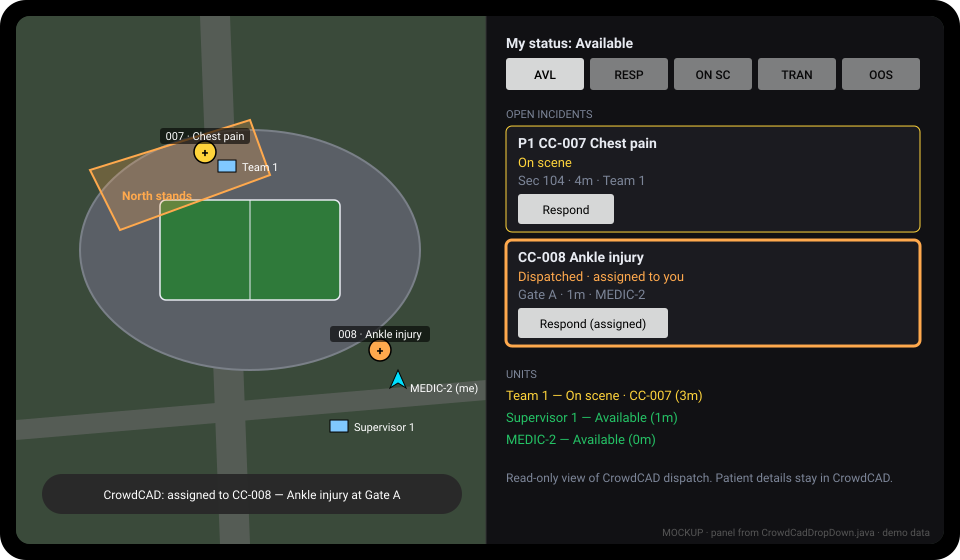

# CrowdCAD for TAK: User Guide

**For:** medics on ATAK, dispatchers, and command staff, the medical branch and the EOC on
CloudTAK or WebTAK.
**In short:** CrowdCAD's live calls, teams and venue zones appear on your TAK map. Medics see
their assignments and set their status from ATAK. Everyone else watches the same board in a
browser, and dispatchers can dispatch from inside CloudTAK.

> **About the pictures:** every image in this guide is a mockup drawn from the real UI code,
> not a screenshot. Your screen may differ slightly.

Your operator sets the system up first; see the [Setup Guide](SETUP_GUIDE.md).

---

## Contents

1. [Which part do I use?](#which-part-do-i-use)
2. [The basics](#the-basics)
3. [Medics: ATAK](#medics-atak)
4. [Dispatchers: CloudTAK](#dispatchers-cloudtak)
5. [Command staff and EOC: CloudTAK or WebTAK](#command-staff-and-eoc-cloudtak-or-webtak)
6. [Game day, start to finish](#game-day-start-to-finish)
7. [When something looks wrong](#when-something-looks-wrong)
8. [Quick reference cards](#quick-reference-cards)

---

## Which part do I use?

| You are | You use | You can |
|---|---|---|
| **Medic / field team** | ATAK with the CrowdCAD plugin | See calls and teams, get assignment alerts, set your status |
| **Dispatcher** | CloudTAK (CrowdCAD → Dispatch), or CrowdCAD itself | Create events and calls, assign units, change statuses, close calls |
| **Command staff, medical branch, EOC** | CloudTAK or WebTAK (CrowdCAD panel) | Watch the board: open calls, teams, anything not on the map |
| **Anyone else on TAK** (ATAK without the plugin, WinTAK, iTAK) | Your normal map | See call and team markers and zones |

---

## The basics

### What you see on the map

| On the map | Means |
|---|---|
| ⊕ coloured circle, labelled `CC-008 · Ankle injury` | A **call** (incident) at a CrowdCAD post |
| Blue friendly unit, labelled `Team 2` | A **team** or **supervisor** |
| Shaded shape, e.g. *North stands* | A **dispatch zone** from the CrowdCAD venue |

### Call status codes


| Code | Meaning |
|---|---|
| **NEW** | Call created, no unit yet (shown red, *no unit*) |
| **DISP** | A unit has been dispatched |
| **RESP** | The unit is responding (en route) |
| **ONSC** | The unit is on scene |
| **TRAN** | The unit is transporting |
| **CLOSED** | Resolved in CrowdCAD (Delivered, Refusal, Treat and Release…). The call leaves every board at once |

**P1** marks a call CrowdCAD flagged as priority. P1 calls sort first.

### What is and isn't shared

The **chief complaint** (e.g. *Chest pain*) is the only clinical detail that reaches TAK.
**Age, sex, notes, call logs and names never leave CrowdCAD.** When you type a chief
complaint, don't put names, age or sex in it.

### "Not on the map"

A call or team appears under **Not on the map** when its location isn't a mapped post, for
example a free-text location like *row 114*. It shows on the boards but gets no map marker,
because the system never guesses where a patient is. Ask dispatch to move it to a post.

---

## Medics: ATAK



### Open the panel

Tap the **CrowdCAD** button in the ATAK toolbar. The panel shows, from top to bottom:

1. **Assigned to you:** the call(s) dispatch gave your team, or *No call assigned to you*.
2. **Open incidents:** P1 first. The border colour is the call status. A **thick border**
   means *assigned to you*.
3. **Units:** every team and supervisor with their status.

Tap any card to centre the map on it.

### Your status is set by dispatch

You can't change your status from ATAK. Dispatch sets it in CrowdCAD (or the CloudTAK
console), and you see it on the boards. Tell dispatch by radio when you're en route, on scene,
transporting or clear, as usual.

### When you're assigned a call

1. The phone **vibrates**, shows a toast like *CrowdCAD: assigned to CC-008 — Ankle injury at
   Gate A*, and opens the call.
2. Tap **Acknowledge** on the call. It changes to *Acknowledged*, and the call's log in
   CrowdCAD shows **`<your team> acknowledged the call. (via ATAK: <your callsign>)`**.
   Acknowledge doesn't change your status.

If your phone isn't linked to your team yet, set your ATAK callsign to your team name
(e.g. *Team 1*). Your first Acknowledge links it.

> **Not getting alerts?** Your device must be mapped to your team. Ask the operator to check
> *Teams carried by their own ATAK device* on the console page.

---

## Dispatchers: CloudTAK

Open the CloudTAK menu → **CrowdCAD Dispatch**. The header says **Bridge OK** when the board is
live (tap it to refresh). If it says *Bridge offline*, the line under it says why.

### The board

- The coloured buttons count units by status: **A** available, **R** responding, **S** on scene,
  **T** transporting, **O** out of service. Tap one to show only those units; tap again to clear.
- **Incidents**: one row per open call, coloured by status. **Red means no unit has been sent.**
  Amber = dispatched, blue = on scene, purple = transporting. Tap a call to open it.
- **Units**: one row per team or supervisor, coloured by status. Tap a unit to fly the map to it.
  *no GPS fix* = no position yet; a faded row = its phone hasn't reported for 3 minutes.

### Create a call

1. Tap **+ New**.
2. Pick the **Type** and **Priority** (P1 = most urgent).
3. **Location**: describe the spot (e.g. *Sec 104 Row 22*) and pick the **Floor** if indoors.
4. **Map position**: click the map, find **what3words**, type **coordinates**, or use the **map
   centre** (saved as an estimate, so the call shows *Position is an estimate*).
5. **Complaint**: short, no names, DOB or MRN. **Reported by**: who called it in.
6. Tap **Create**.

The call is created in CrowdCAD with the point as its location ("lat, lon"); the place, floor and
what3words are written into one `[TAK]` line of the call's notes, so CrowdCAD users see them too.

### Work a call

- **Closest units** lists available units first, then by distance and walking time. Tap
  **Assign**: the unit's phone (ATAK CrowdCAD plugin) vibrates and opens the call.
- **Units around it**: the radar, north up. Tap a unit to fly the map to it, or **Show all on map**.
- Each unit on the call has **Available / Responding / On Scene / Transporting / Out of Service**.
  *Available* sends the unit back to its post; *Out of Service* also puts it On Break. If it was
  the last unit, CrowdCAD closes the call (you're asked first).
- **Dispatched / On Scene / Transporting** set every unit on the call at once.
- **Close** resolves the call; **Cancel** resolves it as cancelled (CrowdCAD's duplicate). Its
  units go back to their posts and the marker leaves every TAK map at once.
- On the map, a dashed line joins each assigned unit to its call.

### Add or remove units

- **Units → + Add**: **Team** or **Supervisor**, a name (supervisors: a certification), and
  optionally the **TAK contact** who carries it. With a contact, that phone's position is the
  unit and assignments alert it.
- **✕** on a unit row removes it from the CrowdCAD event (you're asked first). It leaves any call
  it was on; a call left with no unit goes back to Pending (red).

**Good to know**

- Every change uses CrowdCAD's own rules and is logged **`via CloudTAK: <your user>`**, saved
  safely: a change made in CrowdCAD a moment earlier is never overwritten.
- New calls and units go to the **first live event** on the board.

### WebTAK dispatchers

WebTAK has no built-in dispatch pane. Its **Dispatch** button opens CrowdCAD's own screen in a
floating window (draggable, resizable, with *Open in new window*). Sign in with your CrowdCAD
account.

---

## Command staff and EOC: CloudTAK or WebTAK


- **CloudTAK:** menu → **CrowdCAD Dispatch** (the same board dispatchers use; look, don't touch).
- **WebTAK:** sidebar tool → **CrowdCAD** (read-only).

The WebTAK board shows:The board shows:

- **Open calls**, P1 first, with status and assigned units;
- **Teams** and their status;
- **Not on the map**: anything CrowdCAD couldn't place.

It refreshes every 5 seconds and is read-only: to change anything, use CrowdCAD Dispatch in
CloudTAK, or CrowdCAD itself.

If the bridge stops, the board shows a **warning above the last good board**. The data
underneath is no longer current.

---

## Game day, start to finish

**Before doors**

1. Dispatch starts the event in CrowdCAD, or creates it from CloudTAK.
2. Zones appear on ATAK within seconds.
3. Medics open the CrowdCAD panel, check that they see the event, and set **AVL**.
4. Command checks that **Not on the map** is empty.

**During the event**

| Step | Dispatcher | Medic (ATAK) | Everyone else |
|---|---|---|---|
| 1 | Creates a call at a post | Marker appears on the map | Call appears red, *no unit* |
| 2 | Assigns Team 2 | Team 2's phone vibrates and opens the call | Call turns *Dispatched* |
| 3 | Sees "Team 2 acknowledged the call" in the call log | Taps **Acknowledge** | — |
| 4 | Sets Team 2 *En Route*, *On Scene*, *Transporting* in CrowdCAD as they radio in | — | Colours change on every client |
| 5 | Closes the call | — | Call leaves every board at once |

**After the event:** end it in CrowdCAD (or with **End** in CloudTAK). Everything clears the
same way.

---

## When something looks wrong

| You see | Do this |
|---|---|
| A call on the board but not on the map | It's *Not on the map*. Ask dispatch to move it to a post |
| ATAK says *No open incidents* but dispatch has calls | Calls may all be *Not on the map*, or your device is in the wrong TAK group. Tell the operator |
| No assignment alert | Your device isn't mapped to your team. Tell the operator |
| A warning above the board | The bridge is down. The board is the last good copy. Tell the operator and fall back to radio and CrowdCAD |
| Markers fading out on the map | They age out within 5 minutes if the bridge stops, so stale calls never look current |
| WebTAK says it *can't reach the bridge* | Operator: add WebTAK's page origin on the console page |
| No **Dispatch** button | Operator: fill in *CrowdCAD app URL* on the console page |

**CrowdCAD stays the record.** If TAK and CrowdCAD ever disagree, CrowdCAD is right.

---

## Quick reference cards

### Medic card (ATAK)

```
CrowdCAD button (toolbar) → panel

  AVL    Available         (clears you from your call)
  RESP   Responding
  ON SC  On scene
  TRAN   Transporting
  OOS    Out of service    (On Break when not on a call)

Assigned?  phone vibrates → call opens → tap "Respond (assigned)"
Thick border = your call.   Tap a card = centre the map.
```

### Dispatcher card (CloudTAK)

```
Menu → CrowdCAD Dispatch            red row = call with no unit sent

New call:  + New → Type · Priority · Location · Floor · map point · Complaint (no PHI) → Create
Assign:    open the call → Closest units → Assign   (the phone buzzes)
Status:    per unit on the call: Available · Responding · On Scene · Transporting · Out of Service
Close:     Close / Cancel → the marker leaves every map
Units:     + Add (team/supervisor, TAK contact)  ·  ✕ removes   ·  every change logs "via CloudTAK: <you>"
```

### Command card (CloudTAK / WebTAK)

```
CloudTAK: Menu → CrowdCAD Dispatch      WebTAK: Sidebar → CrowdCAD
Board refreshes every 5 s · P1 first · "Not on the map" should be empty
Warning above the board = bridge down; data is the last good copy
```
